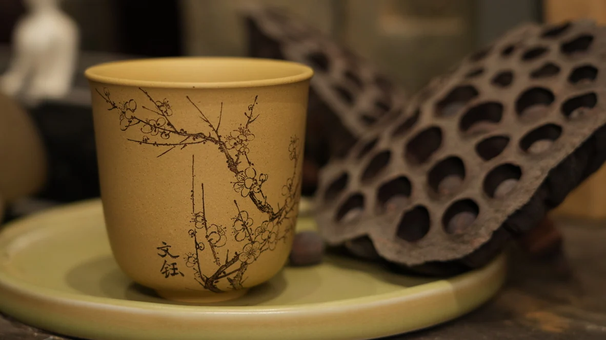

# 赵宇凡 · 日常小铺

你好，我是赵宇凡，一名助理工艺美术师，从 2019 年开始做紫砂刻绘。我把紫砂作品、和小狗多多相处的日常，还有学网页设计时做的作业，都放进了这个小网站。

**[打开个人网站](https://zyf990103-ops.github.io/self-introduction/)** · **[看紫砂作品](https://zyf990103-ops.github.io/self-introduction/#works)** · **[看网页设计作业](https://zyf990103-ops.github.io/self-introduction/design-keywords/)**

*折枝花纹杯｜点击图片，进入紫砂作品展。*

## 网站里有什么？

| 内容 | 可以看到什么 |
| --- | --- |
| [宇凡有饭 · 60 秒自我介绍](https://zyf990103-ops.github.io/self-introduction/yufan-youfan/) | 认识阿凡和小狗多多。 |
| [30 秒个人网站宣传片](https://zyf990103-ops.github.io/self-introduction/website-video/) | 看个人网站和紫砂刻绘作品。 |
| [我和多多](https://zyf990103-ops.github.io/self-introduction/#duoduo) | 一段关于我和小狗多多的日常视频。 |
| [我的茶室](https://zyf990103-ops.github.io/self-introduction/#tea) | 一段自我介绍视频，带你看看我的茶室。 |
| [我的紫砂刻绘](https://zyf990103-ops.github.io/self-introduction/#works) | 12 张作品照片，分为「花草入器」「泥上有趣」「方寸之间」三个小展章。点开照片可以看刻绘细节。 |
| [网页设计关键词作业](https://zyf990103-ops.github.io/self-introduction/design-keywords/) | 从 10 个参考网站整理出的 50 张图，每张都配了设计关键词和一句解释。 |

## 这个网站是怎么做的？

我给网站选了粉蓝配色和手绘风格。首页的我和多多会轻轻摇晃，标题会跳一跳；往下滚动，作品分章出场，像在逛一个小展览。

网站用 HTML、CSS 和 JavaScript 制作，通过 GitHub Pages 发布。想看代码，可以从这里开始：

- [`dist/index.html`](dist/index.html)：个人主页的文字和内容。
- [`dist/motion.css`](dist/motion.css)：页面动效和作品展样式。
- [`dist/site.js`](dist/site.js)：滚动出场和点开作品大图的交互。
- [`dist/design-keywords/`](dist/design-keywords/)：50 张参考图和作业页面。
